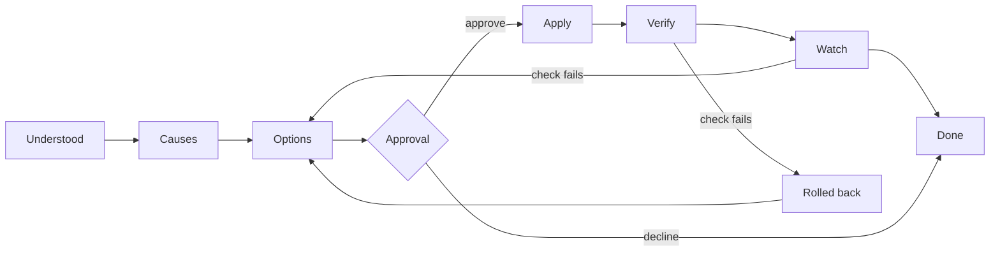

# Working with agents

This guide is for the people who run a cell: admins in the console, and anyone who connects their own assistant to the cell. It explains how the cell's agents work, what you see from them, and what they may do.

Each section says whether it **runs today** or is **planned**. Planned parts name their row in [`backlog.md`](backlog.md); the reasons are in [`decisions.md`](decisions.md) (E-88 to E-92). How it is built is in [`architecture.md`](architecture.md#agent-harness).

## At a glance

| You want to | Today | Planned |
|---|---|---|
| Ask an agent about the cell or an app | Ask box on Home and on an app's page; one answer per task | Follow-ups, the agent asks back, several tasks at once |
| Know the agent understood you | You read its answer | It restates the problem first and asks when unsure |
| Trust its findings | Every API call it made is listed in the task | Every claim links to the call it rests on; numbers come from the platform |
| Judge its proposal | One proposed change with its diff and risk | Options with risk, reversibility, effort and what "done" means |
| Know the fix worked | Health check after the change; a failed update rolls back | Agreed checks right after the change and over the following week |
| See what a change did | Change log | Before and after figures on every change, markers on every chart |
| Use the cell from Claude or another assistant | App tools at the MCP endpoint | Platform tools and tasks, sign-in through the cell's login |

## The idea

An agent in the cell works like a consultant you brought in for one problem:

1. It tells you what it understood before it does anything you would have to undo.
2. It shows what it checked, what it found and what it ruled out, each with its evidence.
3. It proposes options with risk, effort and what "done" will mean, and recommends one.
4. You decide. The platform carries the change out, not the agent.
5. The platform checks that the change did what it promised: once right after it, then over the following days.

The goal is that you do not have to check its work again. Anything an agent claims points to the API call it rests on. Every number you see comes from the platform, not from the model.

## Rules every agent follows

These rules hold for every agent in the cell.

- **Rules first.** The operator does everything a rule can do without a model: install, restart, back up, update, roll back. Agents handle only what no rule covers.
- **Only through the platform API.** An agent has an account of its own and only that account's rights. It has no access to the cluster and no shell.
- **Every call is recorded.** Each API call an agent makes is a step in its task, with its time. *Runs today.* The step also keeps the part of the response the agent saw: *planned* (backlog: Conversations).
- **Agents propose, people decide.** Every change an agent wants waits for an admin's approval. *Runs today.* Planned: agents apply what the platform can undo themselves; you decide only what cannot be undone, what reaches outside the cell and who gets which rights (E-95, backlog: Autonomy levels).
- **Numbers come from the platform.** Risk level, diff, measurements and check results are computed by the platform. The model chooses and explains; you never have to trust a number it typed. *Planned* (backlog: Structured answers).
- **"Done" is agreed before you approve.** A proposed change names the checks that prove it worked. The operator runs them, not the agent. *Planned* (backlog: Checks on a change).

## Tasks

All agent work happens in a **task**. You find tasks in the console under *Agents*; each has its own page.

Who opens a task:

| Who | How | Status |
|---|---|---|
| The operator | An app needs attention (failed health checks, failed change, failed restore): a diagnosis | Runs today |
| An admin | The ask box on Home (about the cell) or on an app's page (about that app) | Runs today |
| An admin | *Apps*, "From an open-source project": the agent packages a Compose file | Runs today |
| Your own assistant, for example Claude | Through the cell's MCP endpoint | Planned |
| Another agent | It hands part of its work to an agent better suited | Planned |
| The office UI | Through the API, for a person's request | Planned |

### Stages

*Planned* (backlog: Structured answers, Checks on a change). A task moves through these stages, and its page shows where it stands:



| Stage | What happens | Who acts |
|---|---|---|
| Understood | The agent restates the problem or goal, its scope (the cell or one app) and its assumptions. If the request can be read more than one way, it stops and asks you. | Agent; you can correct it |
| Causes | For a problem: what it checked and what it found, each cause marked confirmed, ruled out or suspected, with evidence | Agent |
| Options | One to three ways forward. Each has the exact change, its risk and whether it can be undone, the effort or downtime, and the checks that define "done". One is recommended, with the reason. Choosing one closes the others. | Agent |
| Approval | You approve one option (and may edit its checks first) or decline. Your approval holds for exactly what you saw: if the app or the proposal changed since, it goes back to the agent. | You |
| Apply | The operator applies the change with the steps of its kind, for example backup, update, health check and rollback on failure for an update | Operator |
| Verify | The operator runs the agreed checks for a short window. If one fails, it rolls back where the kind of change allows it, and the task goes back to Options. If data is missing, the check is *inconclusive*: nothing rolls back, the task reopens and IT is warned. | Operator |
| Watch | The checks keep running for the watch window. If one fails, the task goes back to Options with the finding. | Operator, agent |
| Done | The receipt: what changed and what the checks measured before and after | |

A question without a change ("which machines are nearly full?") ends after Understood and Causes with its answer.

**Today** a task ends with one answer in plain text and, where needed, one proposed change. After approval the change runs the steps of its kind: an update with backup, health check and rollback on failure; a restart without backup and without rollback; an install that does not become healthy stays installed for diagnosis (E-31, E-73).

### Talking back and forth

*Planned* (backlog: Conversations, Task thread in the console).

- **Follow-ups.** Reply on any task, also a finished one. The agent continues with everything it already found.
- **The agent asks you.** When it needs a decision or a fact, the task shows *Waiting for you* with its question, sometimes as a short form. A secret you type into such a form goes straight into a Secret in the cell, which the cell picks, not the agent. Neither the agent nor the model provider sees it.
- **Correct me.** Fix the agent's understanding on the Understood block. It starts again from there.
- **Ask about this.** Every block, evidence step and chart has this action. It opens a follow-up with that item attached.
- **Several at once.** Agents work on several tasks in parallel, up to a limit per agent; the rest wait as *queued*. If the agent service restarts, each task resumes where it stopped, without doing a step twice.
- **Long tasks.** A task that grows too long for its model stops as *limit reached*. An admin can raise the limit or start a new task from its summary.
- **Stop.** An admin can stop a task at any time; the agent stops working on it. A change it proposed that nobody decided yet stays in the change log and can be declined. A change already approved runs to its end like any approved change. Stopping a task also stops the tasks it handed to other agents.

## What an answer shows

*Planned* (backlog: Structured answers, Task page with stages and depth, Answer blocks).

You choose how deep to look:

| Depth | Shows |
|---|---|
| Summary | The answer in a few lines, with its key blocks |
| Reasoning | Causes, what was ruled out and why, the options compared |
| Evidence | The steps behind each claim, with the part of the response that matters |
| Raw | Every message and tool call of the task, with each response as the agent received it |

Answers are made of the console's own components: an app's state, a usage chart, a log excerpt, the diff of a change, a table of checks. A block names the data it shows, for example "memory of app notes from 09:00 to 10:00 on 27 November", and the console loads that data from the API with your rights. A chart in an answer is therefore the same chart, with the same numbers, as on the app's page. The figures a claim rests on are kept with the answer, so it still shows them after the cell's metrics expire (30 days). A chart without a fixed window is marked *live*.

Each claim links to the steps it rests on. A claim without such a step is marked *unsupported*. What the platform checked looks different from what the agent concluded.

## After you approve

*Apply runs today; the rest is planned* (backlog: Checks on a change, The agent follows its change).

A proposed change carries its **checks**. Every change that leaves the app in place includes "the app is healthy"; the agent adds what fits the problem, for example:

- memory of the app stays below 900 MiB for 24 hours
- no restarts for one hour
- the app answers at its address in under 500 ms (95th percentile)
- a log line no longer appears (once the cell keeps log history)

Checks come from a fixed catalog with parameters. The agent picks and fills them in; you can change them before you approve. The operator measures them from the cell's metrics. A check is passed, failed, or *inconclusive* when data is missing; inconclusive never counts as passed.

Which rollback a change has depends on its kind: an update goes back to its backup; a restart or a removal has none. Data that arrived after the backup is lost on a rollback, and the proposal says so before you approve.

| Window | Default | If a check fails |
|---|---|---|
| Verify | 15 minutes after the change | Automatic rollback where the kind of change has one, as for a failed update today; the task reopens |
| Watch | 7 days | No automatic rollback, because the app may hold new data by then. IT gets a warning, the task reopens with the finding, and the agent proposes what to do. |

While a change is in its verify window, no other change of the same app starts. The next change of the app ends the watch window of the one before.

When the watch window ends, the task is Done and shows its **receipt**: the change, each check with its figures before and after, and links to the change log.

## The impact of every change

*Planned* (backlog: Impact of every change, Availability and response times per app).

This holds for every action in the cell, by a person, an agent or the operator: approved changes, restarts, updates, restores, rollbacks, a machine joining or leaving, a change to mail, models or the backup target. Each writes an action record.

- **Markers on every chart.** Usage charts in the console mark the actions that touched what they show. A marker opens its action.
- **Before and after.** Each action shows the key figures of what it touched (an app, a machine, the cell) for 1 hour, 1 day and 1 week before and after it: processor, memory, restarts, availability and response time.
- **What, not why.** The figures say what changed after an action, not that it caused it. If other actions fall into the same window, the page lists them next to it.

Availability and response times come from two probes per app and from the cell's ingress. One probe goes through the app's public address and measures what people reach, the login included; the other goes from inside the cell straight to the app. Neither needs anything from the app.

If a check fails on a change that no task belongs to, for example one made by hand, the operator opens a diagnosis task.

## What agents may do

**Today** every agent has an account of its own, made from an `Agent` resource: the kinds of tasks it takes, the apps whose tasks it takes, the tools it may call and instructions for its prompt (E-97). The cell comes with two:

- *Ops* diagnoses apps and answers asks, for every app, with every tool.
- *Packer* packages Compose files: it reads the catalog and an app and proposes an install, and cannot restart, restore or remove an app.

Within what its `Agent` allows, an agent may:

- read the cell's apps and machines with their usage over time, an app's pods, events, logs, backups and change log, and the catalog;
- propose an update, a restart or an install, and, when you ask for it, removing an app or bringing back a backup, only for the app of their task. An ask about the whole cell may read the cell's state but not an app's logs, and may not propose changes.

Their tools are the operations of the platform API marked for agents (E-96). The API checks every call against the agent's `Agent`: a task it does not take or a tool it does not have is refused, in a task about one app it sees and changes only that app, and a change to the `Agent` counts from its next call. Agents cannot see people and groups, mail, models or tasks they do not take.

Admins add, change and pause agents with `kubectl` until the console has a screen for it. An agent that only looks into one app:

```yaml
apiVersion: cell.internal/v1alpha1
kind: Agent
metadata:
  name: notes-reader
spec:
  kinds: [diagnose]
  apps: [notes]
  tools: [getApp, listPods, appEvents, appLogs]
  instructions: Answer in German.
```

The operator makes its account `cell-agent-notes-reader.<uid>` with the Agent's UID, its credentials and Deployment `cell-agent-notes-reader` in `cell-system`; `spec.paused: true` stops it. Deleting the Agent deletes its account; an Agent made again under the name gets a new one. If two agents take the same task, the first to claim it works on it.

They may not approve and have no access to the cluster. They cannot read the cell's Secrets, but a log or a manifest can contain anything an app prints or holds, a password too; the agent and its model provider then see it (E-62).

*Planned* (backlog: Agents as accounts, Tools per agent, Autonomy levels):

- Each agent gets a model and budget of its own, and admins manage agents in the console.
- An agent may hand part of a task to another agent. That task shows up as a child of the first, with at most the rights and budget of its parent.
- An agent working on your request has only the rights that both you and it have.
- Agents apply a change themselves when the platform can undo it: an update, a configuration change, a restart, an app from the catalog. Each runs with a snapshot first, its checks and automatic rollback, and shows up in the change log, the task's receipt and a daily summary; you can undo it in one click. You decide what cannot be undone or reaches past the cell: deleting data or backups, uninstalling, restoring over the current state, apps from a manifest outside the catalog or a new image, changes that cost money or reach outside the cell, and who gets which rights, agents included. Admins can tighten this per agent and kind of change (E-95).

## Models

**Today** agents reach their model only through the cell's model gateway. An admin sets one provider in the console (*Organization*, *Models*): Anthropic or any OpenAI-compatible API, hosted or running on your own hardware. The provider key stays in the gateway; each agent and app has its own key to the gateway and an hourly token limit (E-80, E-81).

*Planned* (backlog: Neutral model API, Model per task): agents speak one open model API to the gateway (E-88). Any provider the gateway supports then works for every agent, and you can give a task a different model, with a fallback provider. Later: images and files in a task, speaking a request and hearing the answer, and live voice.

**What reaches the provider:** the task's messages and the tool results the agent reads, for example an app's state or a log excerpt. Secrets typed into a form never do. Choose the provider with this in mind (E-48).

## Use the cell from your own assistant

**Today** the MCP endpoint `https://mcp.<domain>/mcp` offers the tools of every app with an MCP endpoint. Each account sees only the tools of the apps it may use. A client signs in with a token of the identity service for the client `cell-mcp`, valid for five minutes (E-36, E-74).

*Planned* (backlog: Your own assistant over MCP):

- The same endpoint offers the platform's tools (for example the state of an app) and task tools: open a task, reply, read its answer.
- Claude and other MCP clients sign in through the cell's login, with no token to copy (E-92).
- Your assistant acts with your rights, never more, and the change log names both you and the assistant. Approving a change stays in the console: the API refuses it from an assistant.

*Planned* (backlog: Agent to agent): agents in other systems can talk to the cell's agents over the A2A protocol, and the cell's agents can use outside agents and MCP servers that an admin registers (E-90).
