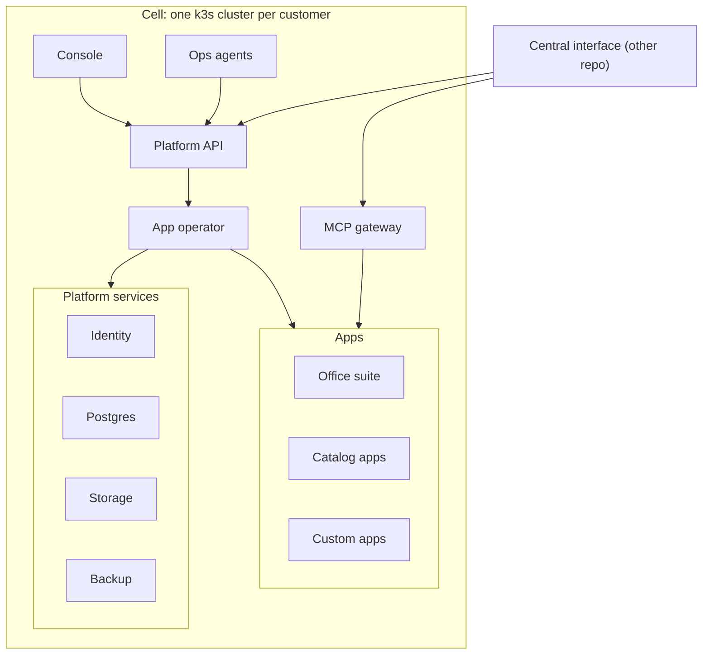
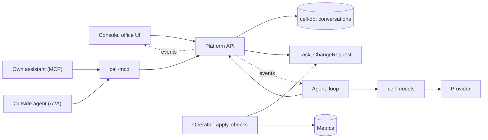

# Architecture

Structure of the platform. Building blocks marked "assumption" are proposals and are justified in `decisions.md`.

## Guiding principles

1. **Deterministic first.** Installing, restarting, backing up, updating and rolling back are rules, not an LLM.
2. **Declarative.** The desired state of every app is in a manifest. An operator creates it and keeps it.
3. **Agents only through the API.** They propose changes to the desired state; the operator always does the execution.
4. **Every change is reversible and logged.** Snapshot, change, health check, rollback on failure.
5. **One cell per customer.** The same package runs on any server, hosted or the customer's own.
6. **Compose instead of building anew.** Own code only for operator, API, agents and console.

## Overview

## The cell

A cell is a k3s cluster with everything a customer needs, on one or more machines (E-42). It is complete in itself and knows no other cells.

- The first machine is the server of the cell (`deploy/install.sh`). Every further machine is added through the console (E-44): the admin creates a join command, runs it on the new machine, and the machine downloads everything it needs from the cell itself.
- All machines of a cell are in one shared network (E-57). Pod traffic runs there encrypted over WireGuard, directly from machine to machine. The machines distribute images among themselves, without a registry.

- Customers are separated at the VM level. This matters because custom apps are foreign code.
- The hosted case and the self-operated case are technically identical.
- A central service across all cells (fleet, billing) is not built yet and does not change the cell.

## Building blocks

| Building block | Task | Implementation |
|---|---|---|
| Base | Run containers, self-healing, rollouts | k3s (assumption) |
| Network between machines | Pods on different machines talk to each other encrypted | WireGuard from k3s (`wireguard-native`, E-42) |
| Images between machines | Platform image on every machine without a registry | built-in mirror of k3s (Spegel, E-42) |
| Network for people | Access to the cell, connection to the company network | Headscale in the cell (E-43, E-56) |
| Ingress and TLS | Every app on its own subdomain | Traefik from k3s, cert-manager |
| App operator | Read the manifest, create and keep the state | Own development, Go with Kubebuilder (assumption) |
| Identity | One account for all apps, groups, agent accounts | authentik (assumption) |
| Databases | One Postgres database per app, continuous backup | CloudNativePG (assumption) |
| Volumes | Files of the apps, snapshots before changes | Longhorn (assumption, checked on a real VM) |
| Metrics | Processor and memory of every machine and container, 30 days | VictoriaMetrics: a collector per machine sends to one store (E-87) |
| Object storage | S3 for apps that need it | Open, only on demand |
| Backup | Daily backup outside the cell, restore | Volume backups and database archive into an S3 bucket |
| Platform API | The only door for UI, CLI and agents | Own development, thin layer over the resources |
| Platform database | Records that are not desired state: task conversations, model usage, later memory and the context index | CloudNativePG cluster `cell-db`, reached only by the API, except own apps writing to the context index (planned, E-92); today it holds the transcripts of tasks (E-98) |
| MCP gateway | One endpoint for the tools of all apps, with permission check | agentgateway, configuration by the operator (E-36) |
| Model gateway | One open model API for agents and apps, any provider behind it | agentgateway in standalone mode, `cell-models` (E-80) |
| Ops agents | Diagnosis, asks, packaging; later more agents | Own development in Go: an own loop on one open model API, Chat Completions (E-88, E-94), see [Agent harness](#agent-harness) |

## Own resources

All are in the API group `cell.internal`.

- **`App`**: an installed app. The spec is the manifest plus the customer's inputs; the status shows phase, version, URL and last backup. For the structure see `app-manifest.md`.
- **`ChangeRequest`**: a proposed or executed change. It holds the originator (human, agent, operator), the diff on the `App` spec, the reason, risk level, snapshot reference and result. The sum of all `ChangeRequest`s is the change log.
- **`Backup`** and **`Restore`**: a backup or a restore of an app, respectively.
- **`Task`**: a job for an agent (diagnosis, ask or packaging), with every API call of the agent as a step and its answer. Together with the `ChangeRequest`s it names, it belongs to the change log (E-34). Its transcript, the items of the conversation, lives in the platform database (E-98). Planned (E-89): the `Task` stays the header of a conversation (state, stage, links); its turns and steps move there too.

The catalog is a folder in the repo (`catalog/<app>/manifest.yaml`), not a resource of its own.

## Flows

**Installation**

1. An `App` is created through the API from a catalog manifest and the customer's inputs.
2. The operator creates, in order: namespace, database with credentials, login client in the identity service, the app itself with the values filled in, subdomain with certificate, backup plan.
3. When the health check is green, the app is `Ready` and its URL is in the status.

**Crash**

Kubernetes restarts the app. If it stays unhealthy beyond a threshold, the operator sets `NeedsAttention` and creates a diagnosis task for the ops agent.

**Update**

1. A new version is set: automatically according to the update rule in the manifest, or through a `ChangeRequest`.
2. The operator takes a snapshot of volumes and database, runs the upgrade and checks the health check.
3. On success the `ChangeRequest` is closed. On failure the operator restores the snapshot and the old version and sets `NeedsAttention`.

**Agent intervention**

Today:

1. Trigger: a `Task`, created by the operator on `NeedsAttention` or by an admin (diagnosis, ask, an app to be packaged).
2. The agent takes it and reads status, pods, logs and events through the API; every call is a step in the task.
3. It proposes a `ChangeRequest` with diff and reason, only for the app of its task; the API sets the risk level.
4. It ends the task with its answer: cause, evidence, proposed change.
5. After approval the operator runs the change like an update, with backup and rollback.

Planned (E-89, stages as in `agents.md`): steps 2 to 4 become turns of a conversation that ends in a structured answer (Understood, Causes, Options). The chosen option's `ChangeRequest` carries checks; after the health check the operator runs them in a verify window (rollback on failure) and a watch window (the task reopens on failure), and writes the receipt.

**Grant access**

"John needs access to app X" becomes a group binding in the identity service. The app sees John at the next login, or he is actively created in it, depending on what its manifest specifies under `provisioning`.

## Agent model

Agents are accounts in the identity service with their own permissions, one per `Agent` resource (E-97). Their tools are exclusively calls to the platform API.

| Level | Examples | Rule |
|---|---|---|
| 0 Read | Status, logs, events, metrics | Always allowed |
| 1 Reversible | Restart, configuration change, update with snapshot, install from the catalog | With approval today; decided: applies itself with its checks and automatic rollback once checks on a change are built (E-95) |
| 2 Risky | Delete data or backups, restore over the current state, uninstall, install from a manifest outside the catalog, a patch to source, needs or subdomain, spend, anything outside the cell, widening of rights | Always with approval by a person signed in to the console (E-95) |

Agents reach their language model only through the cell's model gateway (E-80): one provider an admin sets, with the customer's key, which stays in the gateway; each agent has its own key to the gateway. The provider is replaceable without touching an agent.

## Agent harness

Planned (E-88 to E-90). What runs today is the loop of E-32 on our own Chat Completions client (E-94), without a provider SDK, with the transcript in the platform database (E-98) and replies and questions (E-99): an admin's reply sets the task pending for the same agent, which rebuilds the conversation from the transcript and goes on; the model asks with the tool `ask`, and the task waits as `WaitingForInput`. The model ends a task with the tool `answer`, in parts the API checks against the task: findings name the task's steps, which every tool result carries, and options the changes of the task (E-100). How people use it is in `agents.md`; the order of the work is in `backlog.md`.

**The loop.** Our own in Go, in each agent's Deployment `cell-agent-<name>`, without an agent framework. For each turn it reads the task's conversation from the API, sends it to the model gateway, runs the tool calls the model returns through the platform API (each one a step, as today), appends what came back, and repeats until the model ends the turn or a limit is hit (model calls per turn, the account's token limit). The model may call tools on any turn, several at once; the calls of one turn run side by side and their results go back in order. A turn cut at the token limit or by a filter is dropped and runs none of its calls: the model hears so and does it again, and a second cut in a row ends the run. The agent keeps no state of its own: everything is in the API, so after a restart a task continues from its last item. Tasks run in parallel, each in its own goroutine, up to a limit per agent; the rest wait as *queued*.

**Durable runs.** One run of a task (an attempt) belongs to one agent process at a time: the process claims it with a lease that it renews, and the API refuses writes from a process whose lease ran out or whose attempt number is old. The loop stores every `function_call` item before it runs it. The call goes to the API with the item's ID as idempotency key, and the API keeps the result under that key, so a repeated call returns the first result instead of acting twice. A `ChangeRequest` carries its key as a label, so after a crash between creating it and storing the result the API finds it again instead of creating a second one. On start and after every reconnect the agent first lists the work waiting for it in the API, then follows the event stream from its last event ID: events only wake it, the list is the truth. Scripted tests stop the agent after a stored call and after a created change before its result, deliver an event twice, and run two agents against one task.

**The model API.** One open API between the agent and the gateway, stateless: every call carries the whole conversation (Chat Completions, E-94). A thin client of our own covers only what the loop uses: one completion with function tools and the provider's reasoning passed back; streaming comes with Live progress. The gateway translates to the provider. No provider SDK and no provider's message format in agent code; only the client knows the wire format.

**The transcript.** Typed items of our own, named after Open Responses: `message` (a role and parts), `function_call`, `function_call_output`, `reasoning` (a summary, or the provider's opaque content passed back unchanged), and items of our own with the prefix `cell:` (`cell:answer`, `cell:ask`, `cell:event` for a check result or another wake-up). A part has a media type and either inline content or a reference to an attachment, so images, audio and video fit without a new format. The API stores items in the platform database; steps keep an excerpt of every response, without the cap of 200 that a `Task` status has today.

**What the model sees.** The stored transcript is not sent as it is: for every call the loop builds the model's input from it. `message`, `function_call` and `function_call_output` map one to one to the wire API's messages and tool calls; `cell:answer` and `cell:ask` go as the call of the `answer` or `ask` tool with its arguments and a short result; `cell:event` goes as a message with a fixed text; an attachment the model cannot read becomes a line with its name and type. Opaque reasoning goes back only to the provider and model that wrote it; after a switch only its summary goes, as text. The input has a token budget per model: the newest turns in full, older turns as their answer and step excerpts. If a task still does not fit, it stops in the visible state *limit reached*, and an admin raises the limit or starts a new task from its summary. A child task gets a part of its parent's remaining budget, never more, and children nest only to a fixed depth. A test replays a stored conversation through the pinned gateway to an Anthropic and an OpenAI-compatible backend, and again after a switch of provider.

**Turns end in structure.** The model ends a turn by calling one of two tools, `answer` or `ask`, whose parameters are the answer schema (Understood, Causes, Options, Receipt) or a question with form fields. Tool calls work on every model that matters, unlike strict structured output. The API checks an answer before it stores it: every evidence reference names a step of this task, every option names a `ChangeRequest` draft the API has priced (risk, reversibility, diff). The options of one answer form a group: approving one closes the others in the same call, and a new answer or a correction closes the open options of the answer before. An approval names the exact revision it saw (the change, its checks and the app's generation); the API refuses it if any of them moved, and the operator checks the app's generation again before it starts, so a stale proposal goes back to the agent instead of running. A form field for a secret is a question the API issues, with its own ID, its purpose and its destination (which Secret and key, chosen by the API from the purpose, never by the model); the value goes from the console straight into that Secret and never into an item, an event, a log line or an error message.

**Tools.** Generated from `api/openapi.yaml` (E-96): an operation marked `x-agent` becomes a tool named by its operationId, with its description, and its path and query parameters and the properties of its JSON body as one argument object, every `$ref` inlined. The agent builds the catalog once at start, sorted by name, and refuses to start on a broken one. The agent offers the model only the tools its `Agent` names (E-97); the API stays the only place that enforces rights and refuses every other call. The same catalog serves the loop and, through the MCP gateway, outside assistants (Interop). Tools of apps and of outside MCP servers also go through the API: it calls them through the gateway with the agent's identity and records call and result as a step; an agent never calls an MCP server itself. An outside tool that an admin has not marked as read-only is a proposal that needs approval, marked as one the cell cannot undo.

**Whose rights.** A task records who asked: a person, an assistant on a person's behalf, another agent, or the operator. Every call in the task gets only the rights that both the agent's account and the requester have, and a child task inherits them, never more. The API checks this on every call, not once at the start, so when a person loses a right, the next call of the task that needs it fails and the task shows why. Who may read a task, its items, attachments and children stays as today (E-63), plus the person who asked.

**Live progress.** The API publishes the agent's progress with the vocabulary of AG-UI: run started and finished, step started and finished, tool call, text delta, stage change, waiting for input. These events carry task content, so they go out only on the stream of their task, with the rights needed to read the task, also on replay. The stream for everyone (`GET /v0/events`, open to viewers) carries only that a task changed, its ID and its stage. The console shows it live; nothing polls.

**Answer blocks.** A block in an answer names a component of the console and the query behind it, never the numbers (A2UI messages and a small Svelte renderer, E-92). A query is the ID of a reading operation in `api/openapi.yaml` from a list the console allows, with parameters checked against its schema and the task's scope; never a URL or a method. The console runs it with the viewer's own rights and renders it the same way as on the app's own page. A block that supports a claim has a fixed time window, and the API stores the figures the claim rests on with the answer, so an old answer still shows what it saw after the metrics expire (30 days, E-87); a block without a fixed window is marked *live*. Facts the platform checked (figures, check results, steps) look different from the model's conclusions. An evidence step keeps the part of the response the agent saw; Raw shows every item as the model received it.

**Checks and the watch window.** A `ChangeRequest` gets `spec.checks[]` in the shape of an Argo Rollouts analysis: a template from a fixed catalog with parameters, an initial delay, an interval, a count, a success and a failure condition. A template enters the catalog only together with its data source: processor and memory (E-87) and restarts (the pods' status) first, response times and availability with the probes, a log line only once the cell keeps log history. Each kind of change says which rollback it has: an update goes back to its backup, a restart and a removal have none, a failed install stays installed (E-31, E-73). Data that came in after the backup is lost on a rollback, and the proposal says so before approval. The operator evaluates the checks against the metrics store after the health check (its NetworkPolicy then admits the operator too) and keeps their state in the change's status, so it resumes after a restart. A check is *passed*, *failed* or *inconclusive* (no data, store away, too few samples), and inconclusive never counts as passed. A failure in the verify window rolls back where the kind allows it, as a failed health check does today. An inconclusive verify window and every failure in the watch window add a `cell:event` to the task, reopen it and warn IT; if the change has no task, the operator opens a diagnosis task, as for a failed health check. A check longer than the verify window runs in the watch window. While a change is in its verify window, no other change of the same app starts, and the next change of the app ends the watch window of the one before. The model only picks templates and parameters; it never writes a query.

**Actions and impact.** Every action in the cell writes an action record: approved changes, restores, restarts, automatic rollbacks, machines joining or leaving, and changes to the cell's settings (mail, models, backup target), by a person, an agent or the operator. A record holds the actor, when the action started and ended, its targets and what it affected (the cell, machines, apps), its outcome and its task, if any; the API writes it to the platform database. The impact is computed by the API on read, without a model: for every record, the key figures of what it affected over the same window before and after (1 hour, 1 day, 1 week), and the other records in that window. Markers on charts come from the same records. Availability and response times come from two probes per app: one through its public address, which measures what people reach, the login included, and one from inside the cell straight to the app's service, which measures the app.

**Interop.** Outside assistants use the cell through `cell-mcp`: app tools as today, plus platform tools and task tools, signed in through authentik (E-92). Today the API accepts only tokens of its own client and the console's, and the gateway removes the Authorization header before every backend. So the gateway passes the person's token on to the platform backend only, and the API accepts a token of the MCP client only on the routes for assistants and records both the person and the assistant (E-92). The API refuses an approval made with such a token; hiding the tool is not enough.

Agents in other systems reach the cell's agents over A2A through an adapter in the API, not a gateway backend, because an A2A task that has ended takes no more messages. Each agent has an agent card. A cell `Task` is an A2A context, and each run of the agent in it is an A2A task that ends with the turn (*input-required* when the agent asks). A follow-up is a new A2A task in the same context, and later results (approval, verify, watch) go to the caller as push notifications. Cancelling an A2A task stops the agent's run, not an approved change. Everything ends in the platform API; nothing reaches the cluster past it.

**Records and recovery.** `cell-db` is backed up like an app's database and restored by `make dr-test` with the apps. `Task` headers and `ChangeRequest`s live in the cluster and are lost with it, so a conversation whose header is gone comes back read-only, and no run resumes after a restore: the API starts a new epoch and refuses claims from before it, so nothing done before is done again. The tasks of today move into the database once, as read-only conversations. A conversation is deleted with its task, except what an action record still refers to (its answer and figures), which stays as long as the record. The DR test proves that no finished change runs again.

**Later: more media.** Speech to text and text to speech through the gateway's audio routes, or a speech model in the cell; live voice over a separate realtime connection whose transcript is appended to the task as items. Neither changes the loop.

## Integration and data

The data of third-party apps stays in the apps. Only what is common to all is held centrally, in three layers:

1. **Identity and organization** (built): accounts, groups and roles for humans and agents.
2. **Tool directory** (built, minimal): every app names its MCP endpoint in the manifest. The gateway bundles all endpoints and checks the permissions of the calling account on every call.
3. **Context index** (not built yet): metadata and references to documents, tickets and people across all apps. Apps from our own development can write directly into the database and storage of the platform; third-party apps are indexed.

## Interface to the UI

REST with an OpenAPI description (`api/openapi.yaml`), login through tokens of the identity service. Roles come from groups of the identity service: admins may do everything, agents read and propose changes within their `Agent` (E-97), viewers read the state of the cell only, without people, tasks, pods, events or logs (E-63), all other accounts see nothing (E-46). Every change to an app is created as a `ChangeRequest` without a decision; an admin approves it in a separate call (E-30).

| Area | Purpose |
|---|---|
| `/catalog` | Available apps |
| `/apps` | Install, status, update, remove |
| `/apps/{name}/restart` | New pods, spec and data unchanged (E-73) |
| `/apps/{name}/backups`, `/apps/{name}/restore` | Backups |
| `/backup-target` | Backup target of the cell: read, set after a probe (E-60) |
| `/apps/{name}/access` | Who may use the app |
| `/users`, `/groups` | Organization structure |
| `/changes` | Change log, approve and reject |
| `/apps/{name}/pods`, `/logs`, `/events` | Diagnosis (admins and agents) |
| `/tasks` | Tasks for agents with their steps (admins and agents; answers can quote logs) |
| `/events` | Live events as a stream |
| `/nodes`, `/nodes/joins` | Machines of the cell, join command for another one (E-44) |

The console of the cell (`https://console.<domain>`, E-39) is a client of this API like any other: its own login client in the identity service (`cell-console`, PKCE, E-40), no logic of its own on the server. `GET /v0/login` tells custom clients where and how to log in.

In addition there is the one MCP endpoint of the gateway for the agents in the UI: `https://mcp.<domain>/mcp`, with tokens of the identity service for the client `cell-mcp` (E-36) that last five minutes, because the gateway checks them without asking the identity (E-74).

## Security

- Every app sits behind the login of the identity service. Apps without a login of their own get a login proxy in front.
- Credentials are created in the cell and stay there as secrets.
- The agent service has no cluster permissions, only an API account.
- Join keys are valid for one hour. The API may create only such keys in `kube-system` and may not read secrets (role `cell-api-join-keys` and the admission policy of the same name).
- Only 80 and 443 (TCP) and 3478 (UDP) on the address of the cell are reachable from the internet (E-57). The machines use the ports between machines (6443, 5001 TCP, 51820 UDP) only in their shared network; the load of each machine goes out from the machine itself (E-87); the firewall blocks them from outside. They still listen on all addresses of the machine: without a firewall they would be open (6443 and 10250 require certificates, WireGuard requires keys, the mirror on 5001 is unchecked).
- The mesh is running (E-56); "apps reachable only in the mesh" is not built yet.

## Not built yet

Removing machines and moving apps between machines, apps reachable only in the mesh, a central service for fleet and billing, the agent harness of E-88 to E-90 (conversations, structured answers, checks after a change, impact of changes, MCP and A2A for outside agents), context index, build pipeline for custom apps, migration of existing customers, running open language models in the cell.
