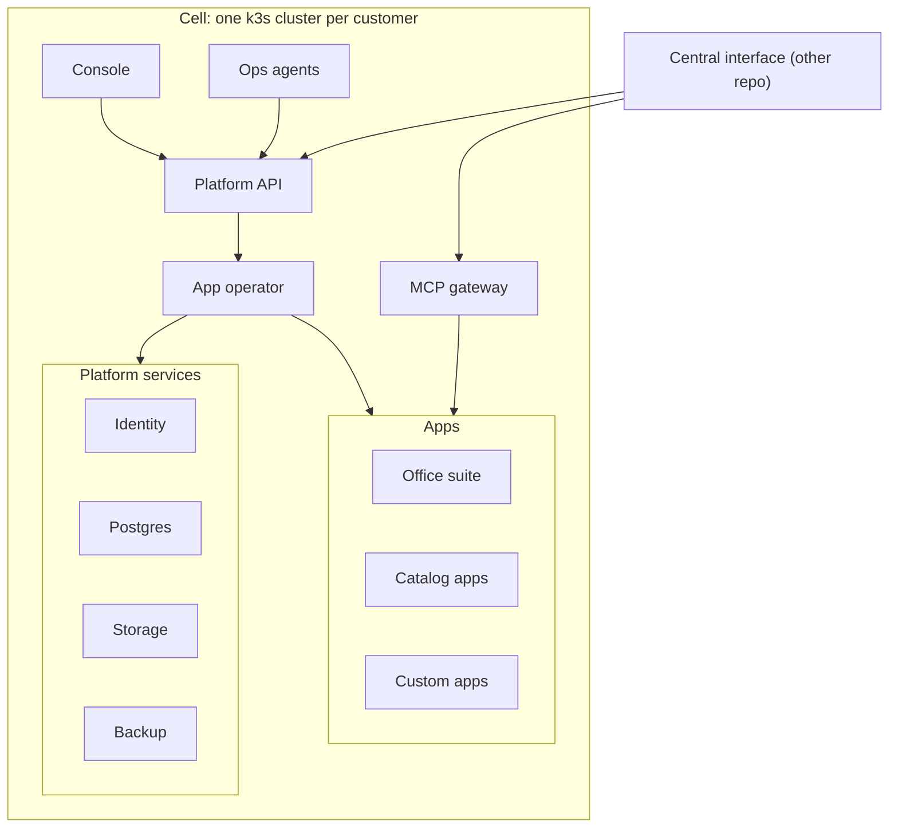

# Architecture

Structure of the platform. Building blocks marked "assumption" are proposals and are justified in `decisions.md`.

## Guiding principles

1. **Deterministic first.** Installing, restarting, backing up, updating and rolling back are rules, not an LLM.
2. **Declarative.** The desired state of every app is in a manifest. An operator creates it and keeps it.
3. **Agents only through the API.** They propose changes to the desired state; the operator always does the execution.
4. **Every change is reversible and logged.** Snapshot, change, health check, rollback on failure.
5. **One cell per customer.** The same package runs on any server, hosted or the customer's own.
6. **Compose instead of building anew.** Own code only for operator, API, agents and console.

## Overview

## The cell

A cell is a k3s cluster with everything a customer needs, on one or more machines (E-42). It is complete in itself and knows no other cells.

- The first machine is the server of the cell (`deploy/install.sh`). Every further machine is added through the console (E-44): the admin creates a join command, runs it on the new machine, and the machine downloads everything it needs from the cell itself.
- All machines of a cell are in one shared network (E-57). Pod traffic runs there encrypted over WireGuard, directly from machine to machine. The machines distribute images among themselves, without a registry.

- Customers are separated at the VM level. This matters because custom apps are foreign code.
- The hosted case and the self-operated case are technically identical.
- A central service across all cells (fleet, billing) is not built yet and does not change the cell.

## Building blocks

| Building block | Task | Implementation |
|---|---|---|
| Base | Run containers, self-healing, rollouts | k3s (assumption) |
| Network between machines | Pods on different machines talk to each other encrypted | WireGuard from k3s (`wireguard-native`, E-42) |
| Images between machines | Platform image on every machine without a registry | built-in mirror of k3s (Spegel, E-42) |
| Network for people | Access to the cell, connection to the company network | Headscale in the cell (E-43, E-56) |
| Ingress and TLS | Every app on its own subdomain | Traefik from k3s, cert-manager |
| App operator | Read the manifest, create and keep the state | Own development, Go with Kubebuilder (assumption) |
| Identity | One account for all apps, groups, agent accounts | authentik (assumption) |
| Databases | One Postgres database per app, continuous backup | CloudNativePG (assumption) |
| Volumes | Files of the apps, snapshots before changes | Longhorn (assumption, checked on a real VM) |
| Metrics | Processor and memory of every machine and container, 30 days | VictoriaMetrics: a collector per machine sends to one store (E-87) |
| Object storage | S3 for apps that need it | Open, only on demand |
| Backup | Daily backup outside the cell, restore | Volume backups and database archive into an S3 bucket |
| Platform API | The only door for UI, CLI and agents | Own development, thin layer over the resources |
| MCP gateway | One endpoint for the tools of all apps, with permission check | agentgateway, configuration by the operator (E-36) |
| Ops agents | Diagnosis, upgrades with migrations, packaging | Own development in Go, language model through the customer's key (E-32, E-33) |

## Own resources

All are in the API group `cell.internal`.

- **`App`**: an installed app. The spec is the manifest plus the customer's inputs; the status shows phase, version, URL and last backup. For the structure see `app-manifest.md`.
- **`ChangeRequest`**: a proposed or executed change. It holds the originator (human, agent, operator), the diff on the `App` spec, the reason, risk level, snapshot reference and result. The sum of all `ChangeRequest`s is the change log.
- **`Backup`** and **`Restore`**: a backup or a restore of an app, respectively.
- **`Task`**: a job for an agent (diagnosis or packaging), with every API call of the agent as a step and its answer. Together with the `ChangeRequest`s it names, it belongs to the change log (E-34).

The catalog is a folder in the repo (`catalog/<app>/manifest.yaml`), not a resource of its own.

## Flows

**Installation**

1. An `App` is created through the API from a catalog manifest and the customer's inputs.
2. The operator creates, in order: namespace, database with credentials, login client in the identity service, the app itself with the values filled in, subdomain with certificate, backup plan.
3. When the health check is green, the app is `Ready` and its URL is in the status.

**Crash**

Kubernetes restarts the app. If it stays unhealthy beyond a threshold, the operator sets `NeedsAttention` and creates a diagnosis task for the ops agent.

**Update**

1. A new version is set: automatically according to the update rule in the manifest, or through a `ChangeRequest`.
2. The operator takes a snapshot of volumes and database, runs the upgrade and checks the health check.
3. On success the `ChangeRequest` is closed. On failure the operator restores the snapshot and the old version and sets `NeedsAttention`.

**Agent intervention**

1. Trigger: a `Task`, created by the operator on `NeedsAttention` or by an admin (diagnosis, an app to be repackaged).
2. The agent takes it and reads status, pods, logs and events through the API; every call is a step in the task.
3. It proposes a `ChangeRequest` with diff and reason, only for the app of its task; the API sets the risk level.
4. It ends the task with its answer: cause, evidence, proposed change.
5. After approval the operator runs the change like an update, with backup and rollback.

**Grant access**

"John needs access to app X" becomes a group binding in the identity service. The app sees John at the next login, or he is actively created in it, depending on what its manifest specifies under `provisioning`.

## Agent model

Agents are accounts in the identity service with their own permissions. Their tools are exclusively calls to the platform API.

| Level | Examples | Rule |
|---|---|---|
| 0 Read | Status, logs, events, metrics | Always allowed |
| 1 Reversible | Restart, configuration change, update with snapshot | With approval; switching to automatic per cell is not built yet |
| 2 Risky | Delete data, restore over the current state, uninstall | Always with approval by a human |

Agents reach their language model only through the cell's model gateway (E-80): one provider an admin sets, with the customer's key, which stays in the gateway; each agent has its own key to the gateway. The provider is replaceable without touching an agent.

## Integration and data

The data of third-party apps stays in the apps. Only what is common to all is held centrally, in three layers:

1. **Identity and organization** (built): accounts, groups and roles for humans and agents.
2. **Tool directory** (built, minimal): every app names its MCP endpoint in the manifest. The gateway bundles all endpoints and checks the permissions of the calling account on every call.
3. **Context index** (not built yet): metadata and references to documents, tickets and people across all apps. Apps from our own development can write directly into the database and storage of the platform; third-party apps are indexed.

## Interface to the UI

REST with an OpenAPI description (`api/openapi.yaml`), login through tokens of the identity service. Roles come from groups of the identity service: admins may do everything, agents read and propose changes, viewers read the state of the cell only, without people, tasks, pods, events or logs (E-63), all other accounts see nothing (E-46). Every change to an app is created as a `ChangeRequest` without a decision; an admin approves it in a separate call (E-30).

| Area | Purpose |
|---|---|
| `/catalog` | Available apps |
| `/apps` | Install, status, update, remove |
| `/apps/{name}/restart` | New pods, spec and data unchanged (E-73) |
| `/apps/{name}/backups`, `/apps/{name}/restore` | Backups |
| `/backup-target` | Backup target of the cell: read, set after a probe (E-60) |
| `/apps/{name}/access` | Who may use the app |
| `/users`, `/groups` | Organization structure |
| `/changes` | Change log, approve and reject |
| `/apps/{name}/pods`, `/logs`, `/events` | Diagnosis (admins and agents) |
| `/tasks` | Tasks for agents with their steps (admins and agents; answers can quote logs) |
| `/events` | Live events as a stream |
| `/nodes`, `/nodes/joins` | Machines of the cell, join command for another one (E-44) |

The console of the cell (`https://console.<domain>`, E-39) is a client of this API like any other: its own login client in the identity service (`cell-console`, PKCE, E-40), no logic of its own on the server. `GET /v0/login` tells custom clients where and how to log in.

In addition there is the one MCP endpoint of the gateway for the agents in the UI: `https://mcp.<domain>/mcp`, with tokens of the identity service for the client `cell-mcp` (E-36) that last five minutes, because the gateway checks them without asking the identity (E-74).

## Security

- Every app sits behind the login of the identity service. Apps without a login of their own get a login proxy in front.
- Credentials are created in the cell and stay there as secrets.
- The agent service has no cluster permissions, only an API account.
- Join keys are valid for one hour. The API may create only such keys in `kube-system` and may not read secrets (role `cell-api-join-keys` and the admission policy of the same name).
- Only 80 and 443 (TCP) and 3478 (UDP) on the address of the cell are reachable from the internet (E-57). The machines use the ports between machines (6443, 5001 TCP, 51820 UDP) only in their shared network; the load of each machine goes out from the machine itself (E-87); the firewall blocks them from outside. They still listen on all addresses of the machine: without a firewall they would be open (6443 and 10250 require certificates, WireGuard requires keys, the mirror on 5001 is unchecked).
- The mesh is running (E-56); "apps reachable only in the mesh" is not built yet.

## Not built yet

Removing machines and moving apps between machines, apps reachable only in the mesh, a central service for fleet and billing, context index, build pipeline for custom apps, migration of existing customers, running open language models in the cell.
