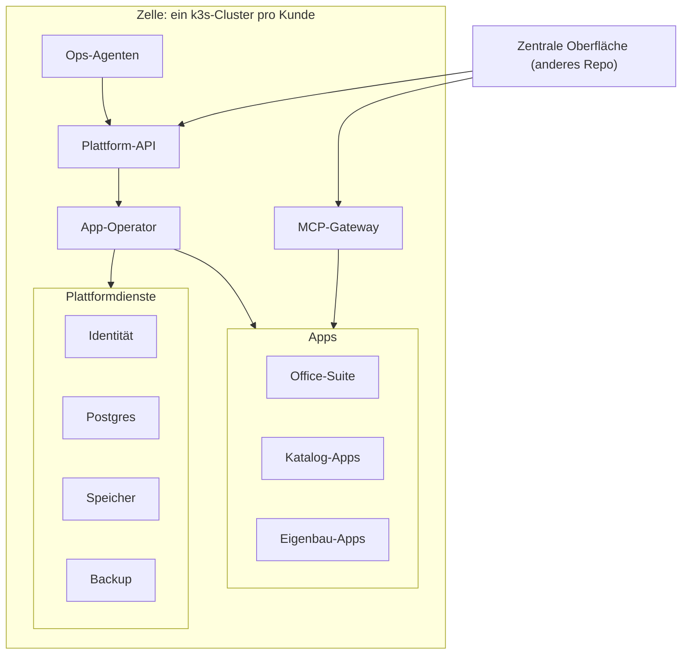

# Architektur

Aufbau der Plattform. Bausteine mit dem Vermerk „Annahme" sind Vorschläge und in `entscheidungen.md` begründet.

## Leitprinzipien

1. **Deterministisch zuerst.** Installieren, neu starten, sichern, updaten und zurückrollen sind Regeln, kein LLM.
2. **Deklarativ.** Der gewünschte Zustand jeder App steht in einem Manifest. Ein Operator stellt ihn her und hält ihn.
3. **Agenten nur über die API.** Sie schlagen Änderungen am gewünschten Zustand vor; ausgeführt wird immer vom Operator.
4. **Jede Änderung ist umkehrbar und protokolliert.** Snapshot, Änderung, Health-Check, bei Fehler Rollback.
5. **Eine Zelle pro Kunde.** Dasselbe Paket läuft in unserer Cloud und auf Kundenservern.
6. **Komponieren statt neu bauen.** Eigener Code nur für Operator, API, Agenten und Konsole.

## Überblick

## Die Zelle

Eine Zelle ist eine VM mit k3s und allem, was ein Kunde braucht. Sie ist in sich vollständig und kennt keine anderen Zellen.

- Kunden sind auf VM-Ebene getrennt. Das ist wichtig, weil Eigenbau-Apps fremder Code sind.
- Der gehostete und der selbst betriebene Fall sind technisch identisch.
- Ein zentraler Dienst über alle Zellen (Flotte, Abrechnung) ist noch nicht gebaut und ändert die Zelle nicht.

## Bausteine

| Baustein | Aufgabe | Umsetzung |
|---|---|---|
| Basis | Container betreiben, Selbstheilung, Rollouts | k3s (Annahme) |
| Ingress und TLS | Jede App unter eigener Subdomain | Traefik aus k3s, cert-manager |
| App-Operator | Manifest lesen, Zustand herstellen und halten | Eigenentwicklung, Go mit Kubebuilder (Annahme) |
| Identität | Ein Konto für alle Apps, Gruppen, Agenten-Konten | authentik (Annahme) |
| Datenbanken | Eine Postgres-Datenbank je App, fortlaufende Sicherung | CloudNativePG (Annahme) |
| Volumes | Dateien der Apps, Snapshots vor Änderungen | Longhorn (Annahme, auf echter VM geprüft) |
| Objektspeicher | S3 für Apps, die ihn brauchen | Offen, erst bei Bedarf |
| Backup | Tägliche Sicherung außerhalb der Zelle, Restore | Volume-Backups und Datenbank-Archiv in einen S3-Bucket |
| Plattform-API | Einzige Tür für UI, CLI und Agenten | Eigenentwicklung, dünne Schicht über den Ressourcen |
| MCP-Gateway | Ein Endpunkt für die Tools aller Apps, mit Rechteprüfung | agentgateway, Konfiguration vom Operator (E-36) |
| Ops-Agenten | Diagnose, Upgrades mit Migrationen, Paketierung | Eigenentwicklung in Go, Sprachmodell über den Schlüssel des Kunden (E-32, E-33) |

## Eigene Ressourcen

Alle in der API-Gruppe `cell.internal`.

- **`App`**: eine installierte App. Die Spec ist das Manifest plus die Angaben des Kunden; der Status zeigt Phase, Version, URL und letztes Backup. Aufbau siehe `app-manifest.md`.
- **`ChangeRequest`**: eine vorgeschlagene oder ausgeführte Änderung. Enthält Urheber (Mensch, Agent, Operator), Diff auf die `App`-Spec, Begründung, Risikostufe, Snapshot-Verweis und Ergebnis. Die Summe aller `ChangeRequest`s ist das Änderungsprotokoll.
- **`Backup`** und **`Restore`**: eine Sicherung bzw. Wiederherstellung einer App.
- **`Task`**: eine Aufgabe für einen Agenten (Diagnose oder Paketierung) mit jedem API-Aufruf des Agenten als Schritt und seiner Antwort. Zusammen mit den `ChangeRequest`s, die sie nennen, gehört sie zum Änderungsprotokoll (E-34).

Der Katalog ist ein Ordner im Repo (`catalog/<app>/manifest.yaml`), keine eigene Ressource.

## Abläufe

**Installation**

1. Über die API entsteht eine `App` aus Katalog-Manifest und Kundenangaben.
2. Der Operator legt der Reihe nach an: Namespace, Datenbank mit Zugangsdaten, Login-Client in der Identität, die App selbst mit eingesetzten Werten, Subdomain mit Zertifikat, Backup-Plan.
3. Ist der Health-Check grün, steht die App auf `Ready` und ihre URL im Status.

**Absturz**

Kubernetes startet die App neu. Bleibt sie über eine Schwelle hinaus ungesund, setzt der Operator `NeedsAttention` und legt eine Diagnose-Aufgabe für den Ops-Agenten an.

**Update**

1. Eine neue Version wird gesetzt: automatisch laut Update-Regel im Manifest oder über einen `ChangeRequest`.
2. Der Operator erstellt einen Snapshot von Volumes und Datenbank, führt das Upgrade aus und prüft den Health-Check.
3. Bei Erfolg wird der `ChangeRequest` abgeschlossen. Bei Fehler stellt der Operator Snapshot und alte Version wieder her und setzt `NeedsAttention`.

**Agenten-Eingriff**

1. Auslöser: eine `Task`, angelegt vom Operator bei `NeedsAttention` oder von einem Admin (Diagnose, neu zu paketierende App).
2. Der Agent übernimmt sie und liest Status, Pods, Logs und Ereignisse über die API; jeder Aufruf steht als Schritt in der Aufgabe.
3. Er schlägt einen `ChangeRequest` mit Diff und Begründung vor, nur für die App seiner Aufgabe; die Risikostufe setzt die API.
4. Er beendet die Aufgabe mit seiner Antwort: Ursache, Belege, vorgeschlagene Änderung.
5. Nach Freigabe führt der Operator die Änderung wie ein Update aus, mit Backup und Rollback.

**Zugriff vergeben**

„John braucht Zugriff auf App X" wird zu einer Gruppenbindung in der Identität. Die App sieht John beim nächsten Login oder bekommt ihn aktiv angelegt, je nachdem, was ihr Manifest unter `provisioning` angibt.

## Agenten-Modell

Agenten sind Konten in der Identität mit eigenen Rechten. Ihre Werkzeuge sind ausschließlich Aufrufe der Plattform-API.

| Stufe | Beispiele | Regel |
|---|---|---|
| 0 Lesen | Status, Logs, Ereignisse, Metriken | Immer erlaubt |
| 1 Umkehrbar | Neustart, Konfigurationsänderung, Update mit Snapshot | Mit Freigabe; pro Zelle auf automatisch schaltbar ist noch nicht gebaut |
| 2 Riskant | Daten löschen, Restore über den aktuellen Stand, Deinstallation | Immer mit Freigabe durch einen Menschen |

Das Sprachmodell kommt über einen API-Key des Kunden und ist austauschbar.

## Integration und Daten

Die Daten fremder Apps bleiben in den Apps. Zentral liegt nur, was allen gemeinsam ist, in drei Schichten:

1. **Identität und Organisation** (gebaut): Konten, Gruppen und Rollen für Menschen und Agenten.
2. **Tool-Verzeichnis** (gebaut, minimal): Jede App nennt im Manifest ihren MCP-Endpunkt. Das Gateway bündelt alle Endpunkte und prüft bei jedem Aufruf die Rechte des aufrufenden Kontos.
3. **Kontext-Index** (noch nicht gebaut): Metadaten und Verweise auf Dokumente, Tickets und Personen über alle Apps hinweg. Apps aus eigener Entwicklung können direkt in Datenbank und Speicher der Plattform schreiben; fremde Apps werden indexiert.

## Schnittstelle zur Oberfläche

REST mit OpenAPI-Beschreibung (`api/openapi.yaml`), Anmeldung über Tokens der Identität. Rollen kommen aus Gruppen der Identität: Admins dürfen alles, Agenten lesen und schlagen Änderungen vor, alle anderen lesen. Jede Änderung an einer App entsteht als `ChangeRequest` ohne Entscheidung; ein Admin gibt sie in einem eigenen Aufruf frei (E-30).

| Bereich | Zweck |
|---|---|
| `/catalog` | Verfügbare Apps |
| `/apps` | Installieren, Status, Update, Entfernen |
| `/apps/{name}/backups`, `/apps/{name}/restore` | Sicherungen |
| `/apps/{name}/access` | Wer darf die App nutzen |
| `/users`, `/groups` | Organisationsstruktur |
| `/changes` | Änderungsprotokoll, Freigeben und Ablehnen |
| `/apps/{name}/pods`, `/logs`, `/events` | Diagnose (Admins und Agenten) |
| `/tasks` | Aufgaben für Agenten mit ihren Schritten (Admins und Agenten; Antworten können Logs zitieren) |
| `/events` | Live-Ereignisse als Stream |

Dazu der eine MCP-Endpunkt des Gateways für die Agenten in der Oberfläche: `https://mcp.<domain>/mcp`, mit Tokens der Identität für den Client `cell-mcp` (E-36).

## Sicherheit

- Jede App liegt hinter dem Login der Identität. Apps ohne eigenes Login bekommen einen vorgeschalteten Login-Proxy.
- Zugangsdaten entstehen in der Zelle und liegen dort als Secrets.
- Der Agenten-Dienst hat keine Cluster-Rechte, nur ein API-Konto.
- „Nur im Firmennetz erreichbar" (VPN oder Mesh pro Zelle) ist noch nicht gebaut (O-05).

## Noch nicht gebaut

Zellen über mehrere Rechner und Standorte (O-23), VPN oder Mesh zwischen Standorten und für Menschen (O-05, O-24), zentraler Dienst für Flotte und Abrechnung, Kontext-Index, Build-Pipeline für Eigenbau-Apps, Migration von Bestandskunden, Betrieb offener Sprachmodelle in der Zelle.
